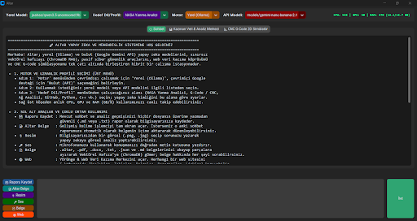
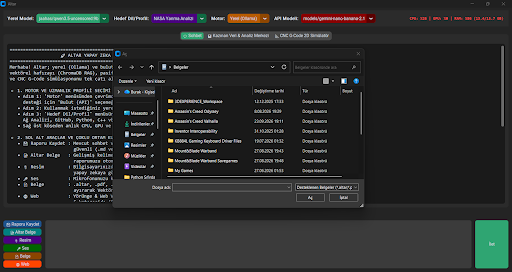
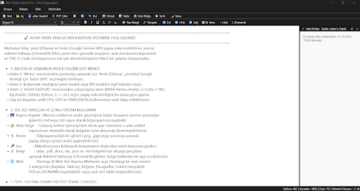
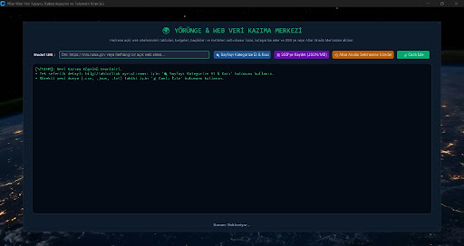
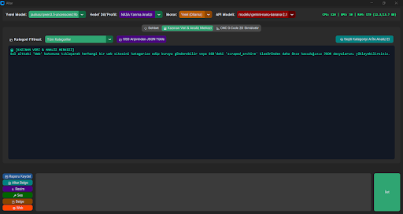
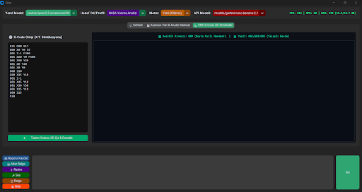
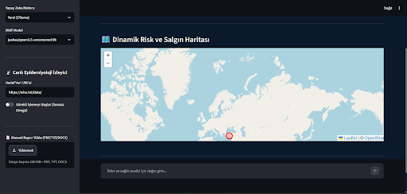
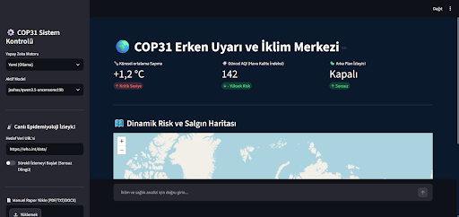

COP31 Projesi için birçok alanda özel olarak eğitilmiş ve tasarlanmış ALTAR uygulaması; Erken uyarı sistemleri, üretim, tasarım, geliştirme, analiz ve genel sohbet gibi alanlarda başarılı sonuçlar veren qwen3.5:9b modelinin sansürsüz modelini çekirdek olarak referans almıştır.

---

## Arayüz ve Sistem Mimarisi

### 1. Ana Komuta Merkezi ve Donanım Takibi
Uygulama başlatıldığında tüm alt modülleri ve donanım telemetrisini canlı olarak yönetebileceğiniz modern bir arayüz sunar.

* **Canlı Telemetri:** Sağ üst köşeden anlık olarak **CPU, GPU ve RAM (GB ve %)** tüketimini takip ederek modelin bilgisayar kaynaklarını ne kadar kullandığını izleyebilirsiniz.
* **Hibrit Motor Seçimi:** İhtiyaca göre tek tıkla **Yerel (Ollama)** veya **Bulut (API)** çekirdekleri arasında geçiş yapabilirsiniz.
* **Dinamik Model ve Profil:** Çevrimdışı çalışırken `qwen3.5`, `dolphin` veya `llama` serisi modelleri; bulutta ise `gemini` sürümlerini seçebilirsiniz. Seçilen uzmanlık profiline göre (*NASA Yanma Analizi*, *G-Code / CNC*, *Ağ Analizi*, *COP31 Sağlık*, vb.) yapay zekanın sistem talimatı otomatik olarak şekillenir.

---

### 2. Çoklu Ortam Araçları ve Vektörel Hafıza (RAG)
Sol alt kontrol panelinden sisteme farklı formatlarda veri besleyebilir ve analiz başlatabilirsiniz:

* 📄 **Geniş Formatlı Belge RAG:** `.altar`, `.pdf`, `.docx`, `.txt`, `.json` ve `.md` uzantılı belgeleri sisteme aktarabilirsiniz. Dosyalar otomatik olarak parçalanıp ChromaDB vektörel hafızasına gömülür ve içerik hakkında anlamsal (semantic) sorgulamalar yapılabilir.
* 📎 **Görsel Analiz (Vision):** Sisteme `.png` veya `.jpg` teknik şemalar, çizimler veya fotoğraflar yükleyerek yapay zekadan anlık görsel analiz ve yorum alabilirsiniz.
* 🎤 **Sesli Komut (STT):** Entegre mikrofon desteğiyle konuşmalarınızı doğrudan komut kutusuna aktarabilirsiniz.
* 💾 **Güvenli Raporlama:** Yaptığınız tüm analizleri üzerine yazma riski olmadan zaman damgalı `.md` veya `.txt` dosyaları olarak kaydedebilirsiniz.

---

### 3. Altar Metin Editörü Pro (Dahili Kelime İşlemci)
Analiz çıktılarını ve teknik raporları düzenlemek için harici bir ofis programına ihtiyaç duymadan kullanabileceğiniz tam ekran bir editör entegre edilmiştir.

* Zengin metin biçimlendirme (fontlar, renkler, hizalama, tablolar, kod blokları ve simgeler).
* Yapay zeka ile yapılan analiz özetlerini doğrudan editör sayfasına aktarma imkanı.
* Sağ tarafta hızlı not ve taslak alanı.
* Kelime, karakter, satır ve tahmini okuma süresi sayacı.
* Tek tıkla `.altar` formatında kaydetme veya **PDF Çıktısı** alma desteği.

---

### 4. Yörünge & Web Veri Kazıma Köprüsü
Açık kaynaklı web sitelerinden (örn. NASA NTRS portalları, akademik veri tabanları veya resmi sağlık siteleri) veri çekmek için geliştirilmiş telemetri köprüsüdür.

* **Akıllı Kategorizasyon:** Hedef web sayfasındaki tabloları, belgeleri, başlıkları, paragrafları ve indirme linklerini salt-okunur şekilde ayıklar.
* **Arşivleme:** Çekilen verileri SSD üzerine yapılandırılmış `JSON` veya `Markdown` olarak depolar.
* **Canlı İzleme (Sonsuz Döngü):** Belirtilen adresi periyodik olarak dinleyerek sayfaya yeni eklenen `.csv`, `.json` veya `.txt` veri setlerini otomatik olarak yakalar.

---

### 5. Kazınan Veri & Analiz Merkezi
Web köprüsünden toplanan veya SSD üzerindeki arşivden yüklenen verilerin incelendiği özel analiz sekmesidir.

* Kategori filtresi üzerinden istenen veri türünü (tablolar, linkler, metinler) seçebilme.
* **"Seçili Kategoriyi AI İle Analiz Et"** butonuyla ayıklanan ham veriyi tek tıkla doğrudan yapay zeka modeline aktararak anında özet ve etki raporu çıkartabilme.

---

### 6. CNC G-Code 2D Takım Yolu Simülatörü
Talaşlı imalat ve makine mühendisliği iş akışları için geliştirilmiş iki boyutlu takım yolu görselleştiricisi ve denetleyicisidir.

* **G-Code Düzenleyici:** Sol panelde `G00`, `G01`, `G02`, `G03`, `G90`, `G91` gibi temel CNC kodlarını manuel yazabilir veya yapay zekaya ürettirebilirsiniz.
* **2D Takım Yolu Çizimi:** Kodları analiz ederek takım hareketlerini koordinat düzleminde çizer:
  * 🔴 **Kesikli Kırmızı:** Boşta hızlı hareketler (`G00`)
  * 🟢 **Düz Yeşil:** Talaşlı işleme ve kesim hareketleri (`G01`, `G02`, `G03`)
* Olası dalma veya koordinat hatalarını tezgaha göndermeden önce görsel olarak denetleme imkanı sağlar.

---

### 7. COP31 Erken Uyarı ve İklim Merkezi (Streamlit Dashboard)
Sistemin afet ve salgın izleme senaryolarını harita üzerinden görselleştiren web tabanlı kontrol panelidir (`web_app.py`).

* **Canlı Metrikler:** Küresel ortalama sıcaklık sapması, anlık Hava Kalite İndeksi (AQI) ve arka plan tarayıcı durumunu gösteren telemetri kartları.
* **Dinamik Risk Haritası:** Yapay zekanın analiz ettiği veya canlı veri akışından tespit ettiği kritik koordinatları (örn. yüksek sıcaklık, kuraklık, salgın tehdidi) OpenStreetMap/Leaflet üzerinde kırmızı risk alanları olarak işaretler.
* **Otonom Tool Calling:** Sohbet esnasında AI arkaplanda `AQI_SCAN:::`, `HEALTH_SEARCH:::`, `MAP_ALERT:::` gibi komutları otonom olarak işleterek haritayı ve verileri canlı günceller.

---

## 🛠️ Kurulum ve Gereksinimler

Proje ortamını hazırlamak için terminalinizde aşağıdaki adımları sırayla takip edin:

### 1. Kütüphanelerin Kurulumu
Komutların hatasız çalışması için kütüphaneleri sırayla kurabilirsiniz:

pip install customtkinter
pip install ollama
pip install chromadb
pip install requests
pip install beautifulsoup4
pip install duckduckgo-search
pip install google-genai
pip install folium
pip install streamlit
pip install streamlit-folium
pip install PyMuPDF
pip install python-docx
pip install Pillow
pip install SpeechRecognition
pip install pyaudio
pip install python-dotenv

2. Yerel Yapay Zeka (Ollama)
Çevrimdışı modelleri çalıştırmak için kurun ve modeli indirin:
ollama pull jaahas/qwen3.5-uncensored:9b
ollama pull llava:latest

3. API Anahtarı Yapılandırması :
Google Gemini bulut modellerini kullanmak için ana dizinde bir .env dosyası oluşturup API anahtarınızı ekleyin:

GEMINI_API_KEY="Enter_Your_API_Key"

4. Kodları Çalıştırma :
Web sitesi olarak çalıştırmak için bir terminal veya IDE açın ve yazın :
streamlit run web_app.py

Uygulama olarak açmak için bir terminal veya IDE açın ve yazın :
python Local AI.py

5. Uyarı :
Sistem içinde yer alan anti-malware güvenlik kalkanı, modelin ürettiği veya web üzerinden kazınan metinlerdeki sisteme zarar verebilecek kabuk komutlarını (rm -rf, os.system, tersine bağlantı scriptleri vb.) filtreleyerek kullanıcıyı uyarır.

Üretilen G-Code ve iklim telemetri verilerinin gerçek imalat ve sahada uygulanmadan önce uzman kontrolünden geçirilmesi tavsiye edilir.

Bu proje ile yapılabilecek herhangi bir zararlı kod veya kullanımdaki sorumluluk tamamen kullanıcıya aittir.
